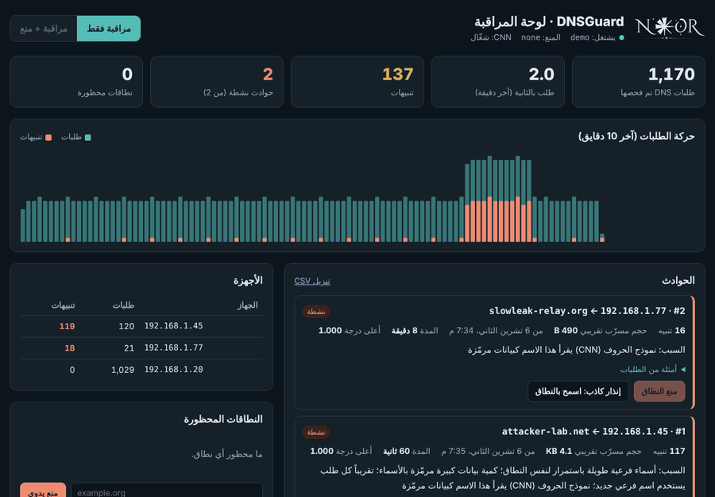

<div align="center">


# DNSGuard — Live DNS Exfiltration Detection & Prevention

**Leakage-aware machine learning that catches data smuggled through DNS — and stops it at the resolver.**

[](https://www.python.org/)
[](#how-it-works)
[](LICENSE)
[](#quick-start-30-seconds)

### ▶ [**Open the live web demo**](https://<your-username>.github.io/DNSGuard/) &nbsp;·&nbsp; no install, runs in the browser

</div>

> **This repository is a working prototype.** It runs end-to-end on a built-in **simulation** so anyone can see it in
> action in 30 seconds — no network setup, no data to download. The detection engine is the real thing: the same models,
> features and policy described in our research. To go live, you swap the data source from `demo` to a real DNS log or a
> live capture — nothing else changes.

<div align="center">

<br><em>The dashboard detecting two exfiltration channels (fast Base32 + low-and-slow Hex) in the built-in simulation.</em>
</div>

---

## The problem

DNS is allowed on virtually every network and is rarely inspected, which makes it an easy channel for **data
exfiltration**: an attacker encodes stolen data into the *subdomains* of queries to a domain they control
(`mzxw6ytb….c2.attacker.net`) and reassembles it on their server. Encrypted DNS (DoH) hides the query name entirely.

Most published detectors report near-perfect accuracy — but they evaluate on **random splits**, where the same attacker
domains appear in both training and test. That is like an exam whose questions are the practice questions. On a real
network, facing **unseen tools and domains**, that accuracy collapses and false alarms explode.

## What DNSGuard does differently

DNSGuard is built and evaluated to be **leakage-aware**: it is tested on tools and domains it has never seen, with a
threshold calibrated on *out-of-group* traffic so false alarms stay low in the real world.

| | |
|---|---|
| 🎯 **Detects** | Fast tunnels *and* low-and-slow leaks (one query a minute), including unseen encodings |
| 🧠 **Three models** | XGBoost on 29 + 37 engineered features, plus a character-level CNN that reads the name itself |
| 🛡️ **Prevents** | Blocks the attacker domain at the resolver (dnsmasq, Pi-hole, Unbound, BIND/RPZ) — the channel stops |
| 🗂️ **Explains** | Every incident comes with a plain-language reason and an estimate of bytes leaked |
| 📊 **Low false alarms** | Allowlist + domain-popularity + incident-grouping policy on top of the models |
| 🌐 **Reads anything** | Pi-hole / dnsmasq / BIND / Unbound / Zeek logs, live capture, pcap, or CSV |

---

## Quick start (30 seconds)

```bash
git clone https://github.com/<your-username>/DNSGuard.git
cd DNSGuard
pip install -r requirements.txt
python3 -m dnsguard_live --bundle dnsguard_bundle_v4.zip --source demo
```

Then open **http://localhost:8080/** . You will see a normal device, a fast Base32 leaker and a slow Hex leaker — and
DNSGuard catching the two attackers while leaving the normal device alone.

> On Windows: `run_demo.bat` · On macOS/Linux: `./run_demo.sh`
> The character-CNN needs PyTorch; without it the system runs on the tree models only. Install the full stack with
> `pip install -r requirements-full.txt`.

---

## Live web demo (no install)

A self-contained, browser-only version of the dashboard lives in [`docs/index.html`](docs/index.html). It **replays a
recorded run of the real system** on simulated traffic — the same engine, models, features and policy — so anyone can
watch DNSGuard catch the attacks without installing anything.

**To publish it as a website:** on GitHub, open **Settings → Pages**, set *Source* to **Deploy from a branch**, choose
branch `main` and folder **`/docs`**, and save. Your demo goes live at `https://<your-username>.github.io/DNSGuard/`.
Share that link.

---

## How it works

```
 DNS queries ─▶ feature engine (37 features) ─▶ 3 models ─▶ policy ─▶ incident ─▶ dashboard
  (log / capture)                                                        │
                                                                         └─▶ (block mode) ─▶ block domain on the resolver
```

1. **Feature engine** — for every query, computes 37 features *in a streaming fashion*, identical to how they are
   computed in training (verified for exact parity): lexical (length, entropy, encoding), behavioural (new subdomains
   per minute / hour) and per-session (a device's average behaviour toward a domain).
2. **Models** — `v2` (XGBoost, 29 features), `v4` (XGBoost, 37 features + rate augmentation to catch slow leaks), and a
   **character CNN** that reads the subdomain letter by letter, so it flags encoded names even on a brand-new domain.
3. **Policy** — alert if *(any tree model ≥ its threshold OR the CNN ≥ its threshold)* **and** the domain is not in the
   top-10k allowlist **and** fewer than 5 devices queried it in the last hour. An **incident** = 3 alerts for the same
   (device, domain) within 10 minutes.
4. **Prevention** — on an incident in `block` mode, the registrable domain is added to the resolver's block list, so
   every subdomain the tool generates is refused.

The models are trained separately in a Kaggle notebook and shipped here as `dnsguard_bundle_v4.zip`. **This repo does no
training** — it runs the ready models on live queries.

---

## Going live

Swap `--source demo` for a real source — the engine, policy, dashboard and blocking are unchanged:

```bash
# Monitor a real Pi-hole / dnsmasq resolver
python3 -m dnsguard_live --bundle dnsguard_bundle_v4.zip \
    --source pihole:/var/log/pihole/pihole.log

# Detect AND block, on a dnsmasq resolver
python3 -m dnsguard_live --bundle dnsguard_bundle_v4.zip \
    --source dnsmasq:/var/log/dnsmasq/queries.log \
    --mode block --block-backend dnsmasq \
    --reload-cmd "sudo systemctl reload dnsmasq" \
    --never-block your-company.com
```

| Source | Use |
|---|---|
| `dnsmasq:PATH` / `pihole:PATH` | dnsmasq or Pi-hole query log (most common) |
| `bind:PATH` / `unbound:PATH` | BIND / Unbound query log |
| `zeek:PATH` | Zeek `dns.log` |
| `sniff:eth0` | live capture off the wire (root + `scapy`) |
| `pcap:PATH` / `csv:PATH` | replay a capture / a Daumel-style CSV |
| `demo` | built-in simulation (default) |

Block backends: `dnsmasq` · `pihole` · `unbound` · `rpz` (BIND) · `command` (your own). Use `--dry-run` to log block
actions without executing them.

---

## Measuring it in a lab

The [`lab/`](lab) folder sets up a reproducible 3-VM experiment on an isolated network. The **attack itself is produced
by the established tunnelling tools** (iodine, dnscat2, dns2tcp, dnsexfiltrator) — the same tools the training data is
built from; our scripts only measure and record ground truth, they do not generate attacks.

```bash
python3 lab/evaluate_lab.py --db dnsguard_events.sqlite --truth ground_truth.csv --received received.csv
# -> detection (recall), false-alarm rate, and how much data was stopped after blocking
```

See [`lab/`](lab) and [`README_AR.md`](README_AR.md) for the full walkthrough.

---

## Roadmap

- [ ] Lab validation against real tunnelling tools, with numbers
- [ ] **DoH module** — detection on encrypted DNS (via a resolver acting as a DoH gateway)
- [ ] Per-seed GCT threshold calibration before final submission
- [ ] Conference submission of the accompanying paper

---

## Project layout

```
dnsguard_live/        the detection engine, sources, blocker, app and dashboard
lab/                  isolated-lab setup, traffic generator, and evaluation
dnsguard_bundle_v4.zip  the trained models (XGBoost + CharCNN) from Kaggle
docs/                 screenshots and the demo GIF
README_AR.md          full guide in Arabic
```

---

## Author

**Noor Muhannad Ahmed** — Researcher in AI & Cybersecurity · IEEE Member
ORCID: [0009-0005-8126-2452](https://orcid.org/0009-0005-8126-2452)

Based on the research paper *"From Audit to Deployment: Leakage-Aware Detection of DNS Exfiltration over Plaintext and
Encrypted DNS."*

## License

Released under the [MIT License](LICENSE) © 2026 Noor Muhannad Ahmed.
